# Casos de Uso — StudyTrack

## Diagrama (atores x casos de uso)

```mermaid
flowchart LR
    Estudante((Estudante))
    Professor((Professor))
    Coordenador((Coordenador))

    Estudante --> UC1[UC-01 Autenticar-se]
    Professor --> UC1
    Coordenador --> UC1

    Estudante --> UC2[UC-02 Consultar Situação Acadêmica]
    Professor --> UC3[UC-03 Registrar Nota]
    Professor --> UC4[UC-04 Criar Plano de Recuperação]
    Professor --> UC5[UC-05 Consultar Relatórios]
    Coordenador --> UC5
    Coordenador --> UC6[UC-06 Cadastrar Estudante]
    Coordenador --> UC7[UC-07 Cadastrar Disciplina e Turma]
    Professor --> UC8[UC-08 Registrar Frequência]
    Professor --> UC9[UC-09 Cadastrar Atividade e Registrar Entrega]
    Professor --> UC10[UC-10 Consultar Dashboard da Turma]
    Administrador((Administrador)) --> UC11[UC-11 Gerenciar Contas]
    Estudante --> UC12[UC-12 Definir ou Alterar Senha]
    Professor --> UC12
    Coordenador --> UC12
    Administrador --> UC12
    Professor --> UC13[UC-13 Consultar Histórico de Notas]
    Coordenador --> UC13
    Administrador --> UC1
    Administrador --> UC14[UC-14 Gerenciar Cursos]
    Coordenador --> UC15[UC-15 Montar a Grade do Curso]
    Estudante --> UC16[UC-16 Consultar o Dashboard Inicial]
    Professor --> UC16
    Coordenador --> UC16
    Administrador --> UC16
    Administrador --> UC17[UC-17 Gerenciar Períodos Letivos]
    Coordenador --> UC18[UC-18 Consultar Auditoria]
    Administrador --> UC18
    Estudante --> UC19[UC-19 Emitir Boletim e Histórico]
    Coordenador --> UC19
    Coordenador --> UC20[UC-20 Importar Estudantes]
    Estudante --> UC21[UC-21 Consultar Notificações]
    Professor --> UC21
    Estudante --> UC22[UC-22 Simular Notas]
    Professor --> UC22
    Professor --> UC23[UC-23 Publicar Comunicado]
    Coordenador --> UC23
    Estudante --> UC24[UC-24 Consultar o Mural]
    Professor --> UC24
    Coordenador --> UC24
    Administrador --> UC25[UC-25 Corrigir Cadastro]
    Coordenador --> UC25
    Professor --> UC25
    Estudante --> UC26[UC-26 Pedir Redefinição de Senha]
    Professor --> UC26
    Coordenador --> UC26
    Administrador --> UC26
    Administrador --> UC27[UC-27 Virar o Semestre]
    Administrador --> UC28[UC-28 Alterar Situação do Estudante]
    Administrador --> UC29[UC-29 Registrar Abono de Faltas]
    Administrador --> UC30[UC-30 Manter Ficha do Estudante]
    Coordenador --> UC30
    Estudante --> UC30
    Administrador --> UC31[UC-31 Manter Dados da Instituição]
    UC29 -.include.-> REC
    Estudante --> UC32[UC-32 Abrir Requerimento]
    Professor --> UC33[UC-33 Responder Requerimento]
    Administrador --> UC33
    Coordenador --> UC34[UC-34 Montar Matriz Curricular]
    Estudante --> UC35[UC-35 Rematricular-se]
    Professor --> UC36[UC-36 Fechar e Homologar Diário]
    Coordenador --> UC36
    Administrador --> UC37[UC-37 Manter Calendário Acadêmico]
    Coordenador --> UC38[UC-38 Montar Grade Horária]
    Administrador --> UC38
    Administrador --> UC39[UC-39 Aproveitamento e Conclusão]
    Administrador --> UC40[UC-40 Exportar Apoio ao Censo]

    UC3 -.include.-> REC[Recalcular Indicador Acadêmico]
    UC8 -.include.-> REC
    REC -.include.-> ALE[Emitir Alerta de Atenção/Risco]
    UC10 -.extend.-> UC4
```

Os casos de uso completos estão em arquivos individuais nesta pasta: `UC-01-autenticar.md`, `UC-02-consultar-situacao-academica.md`, `UC-03-registrar-nota.md`, `UC-04-criar-plano-recuperacao.md`, `UC-05-consultar-relatorios.md`, `UC-06-cadastrar-estudante.md`, `UC-07-cadastrar-disciplina-turma.md`, `UC-08-registrar-frequencia.md`, `UC-09-cadastrar-atividade-registrar-entrega.md` `UC-10-consultar-dashboard-turma.md`, `UC-11-gerenciar-contas.md`, `UC-12-definir-alterar-senha.md`, `UC-13-consultar-historico-notas.md`, `UC-14-gerenciar-cursos.md`, `UC-15-montar-grade-curso.md`, `UC-16-consultar-dashboard.md` e os UC-17 a UC-40 (um arquivo por caso de uso, mesmo padrão de nome; UC-25 a UC-31 incluídos em 2026-11-06 com as SPEC-026 a SPEC-035 e UC-32 a UC-40 em 2026-11-08 com as SPEC-036 a SPEC-043).

Todo RF tem caso de uso (ver `docs/rastreabilidade.md`). Diagramas de sequência dos UC-03 e UC-04 em `docs/uml/sequencias.md`.
