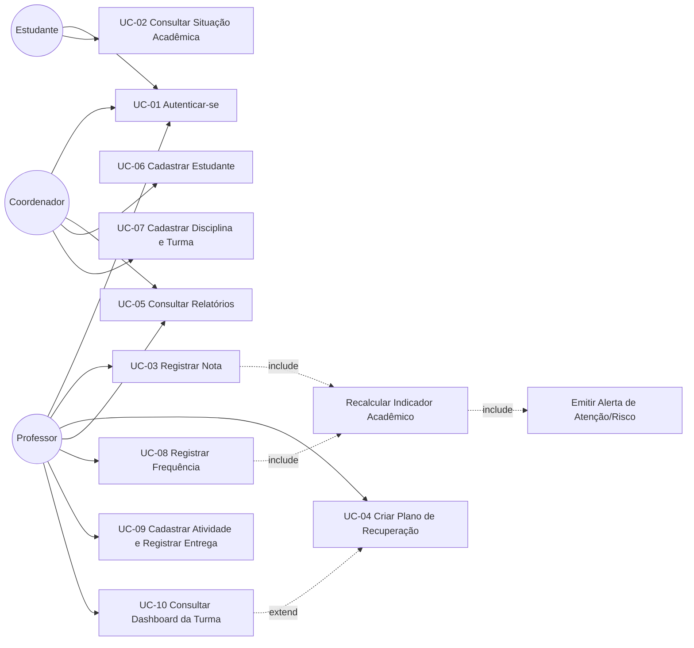

# Casos de Uso — StudyTrack

## Diagrama (atores x casos de uso)

Os casos de uso completos estão em arquivos individuais nesta pasta: `UC-01-autenticar.md`, `UC-02-consultar-situacao-academica.md`, `UC-03-registrar-nota.md`, `UC-04-criar-plano-recuperacao.md`, `UC-05-consultar-relatorios.md`, `UC-06-cadastrar-estudante.md`, `UC-07-cadastrar-disciplina-turma.md`, `UC-08-registrar-frequencia.md`, `UC-09-cadastrar-atividade-registrar-entrega.md` e `UC-10-consultar-dashboard-turma.md`.

Todo RF tem caso de uso (ver `docs/rastreabilidade.md`). Diagramas de sequência dos UC-03 e UC-04 em `docs/uml/sequencias.md`.
