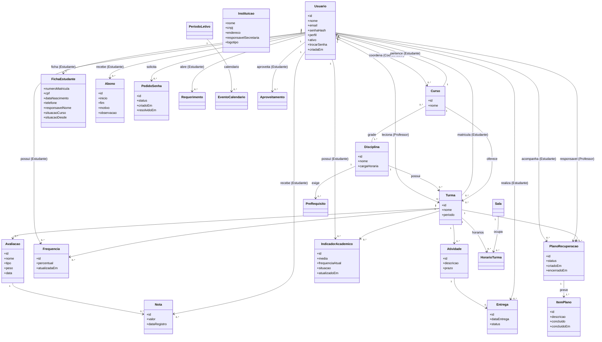

# Modelo de Domínio — StudyTrack

## Classes e responsabilidades

- **Usuario** — id, nome, email, senhaHash, perfil {Estudante, Professor, Coordenador, Administrador}, ativo. Representa qualquer pessoa que acessa o sistema; o atributo `perfil` define o papel (um usuário, não classes separadas). `ativo` (padrão: sim) é alterado só pelo Administrador (RB-14, OPEN-025); conta inativa não entra no sistema, mas seus dados permanecem. `trocarSenha` (padrão: não) marca conta criada pela tela que ainda não definiu a própria senha (RB-15, OPEN-026). `criadaEm` registra quando a conta foi criada (dashboard do administrador, OPEN-034).
- **Curso** — id, nome (único). Organiza a grade de disciplinas, as turmas e os estudantes; tem exatamente 1 coordenador (RB-17, OPEN-030).
- **PeriodoLetivo** — id, nome (AAAA/1 ou AAAA/2, único), status {Aberto, Encerrado}, criadoEm, encerradoEm, rematriculaInicio e rematriculaFim (janela de rematrícula, OPEN-060). Período encerrado torna as turmas dele somente leitura (RB-20, OPEN-040).
- **Turma** — id, nome, vagas (OPEN-060), diario {Aberto, Fechado, Homologado} com as datas e a observação da devolução (OPEN-061). Pertence a exatamente 1 Curso (RB-18, OPEN-031) e a exatamente 1 PeriodoLetivo (OPEN-040; antes o período era um texto).
- **Disciplina** — id, nome, cargaHoraria.
- **Avaliacao** — id, nome, tipo {Prova, Trabalho, Substitutiva, Exame}, peso, data. No máximo uma Substitutiva e um Exame por turma; a Substitutiva troca a menor prova (RB-28) e o Exame dá a nota final (RB-29) (OPEN-051).
- **Nota** — id, valor, dataRegistro.
- **Frequencia** — id, percentual, atualizadaEm. Desde a SPEC-018 o percentual é calculado pela chamada (RB-21, OPEN-041).
- **Aula** — id, data, numero (1 a 4), conteudo (OPEN-061), registradaEm. De 1 a 4 aulas por turma e data (OPEN-041, OPEN-050).
- **Presenca** — presente (sim/não). Uma por estudante e aula.
- **Atividade** — id, descrição, prazo.
- **Entrega** — id, dataEntrega, status {NoPrazo, Atrasada, Pendente}. O status é **derivado** de prazo, data da entrega e data atual (OPEN-010); só a entrega registrada é persistida, e "Pendente"/"Atrasada" sem entrega não geram registro.
- **IndicadorAcademico** — id, media, frequenciaAtual, situacao {Normal, Atenção, Risco}, atualizadoEm.
- **PlanoRecuperacao** — id, status {Ativo, Encerrado}, criadoEm, encerradoEm. O progresso é **derivado** dos itens (RB-12), não gravado (OPEN-021).
- **ItemPlano** — id, descrição, concluído, concluídoEm. Item próprio do plano; o professor marca, o estudante só vê (OPEN-021, OPEN-027).
- **HistoricoNota** — id, valorAnterior (vazio no lançamento), valorNovo, registradoEm. Um registro por lançamento ou alteração de nota, com o autor; nunca editado nem apagado (RB-16, OPEN-028).
- **RegistroAuditoria** — id, categoria {Administrativa, Acadêmica}, ação, descrição, antes, depois, registradoEm. Um por escrita, gravado na mesma transação; nunca editado nem apagado (RB-22, OPEN-039).
- **Comunicado** — id, título, texto, criadoEm. Aviso de um professor ou coordenador para exatamente um alcance: 1 Turma ou 1 Curso; só o autor apaga (RB-26, OPEN-047).
- **Matricula** — situacao {Cursando, Trancada, Cancelada}. Liga 1 Estudante a 1 Turma; trancada ou cancelada sai das listas de trabalho e fica no histórico (RB-30, OPEN-053).
- **FichaEstudante** — numeroMatricula (único, imutável), cpf, dataNascimento, telefone, responsavelNome, responsavelTelefone, situacaoCurso {Ativo, Trancado, Transferido, Cancelado, Concluído}, situacaoDesde, situacaoMotivo. Exatamente 1 por estudante; dados pessoais só para administrador, coordenador do curso e o próprio estudante (RB-33, OPEN-055).
- **Abono** — id, inicio, fim, motivo {AtestadoMedico, ExerciciosDomiciliares, LicencaMaternidade, ServicoMilitar, Outro}, observacao, criadoEm. Registrado pela secretaria; a falta numa aula do intervalo conta como presença (RB-31, OPEN-054).
- **PedidoSenha** — id, status {Pendente, Aprovado, Recusado}, criadoEm, resolvidoEm. No máximo 1 pendente por conta; a senha provisória nunca é guardada nele (RB-27, OPEN-049).
- **Instituicao** — nome, cnpj, endereco, cidadeUf, telefone, email, responsavelSecretaria, logotipo, atualizadaEm. Registro único usado no cabeçalho e na assinatura dos documentos (OPEN-055).
- **Requerimento** — id, protocolo (único: ano + 6 dígitos), tipo {RevisaoProva, SegundaChamada, DeclaracaoMatricula, Trancamento, Outro}, destino {Professor, Secretaria}, descricao, status {Aberto, EmAnalise, Deferido, Indeferido}, resposta, prazo, criadoEm, respondidoEm. De 1 estudante; revisão e segunda chamada têm 1 Turma (e, se houver, 1 Avaliacao) (RB-34, OPEN-058).
- **PreRequisito** — par (disciplina, requisito) dentro da matriz de 1 Curso, sem ciclo (RB-41, OPEN-059). A matriz é a grade (CursoDisciplina) com semestre sugerido e obrigatória/optativa.
- **EventoCalendario** — id, tipo {InicioAulas, FimAulas, Feriado, Recesso, SemanaProvas, Outro}, titulo, inicio, fim. De 1 PeriodoLetivo (RB-38, OPEN-062).
- **Sala** — id, nome (único), capacidade. **HorarioTurma** — diaSemana (1 = segunda a 6 = sábado), inicio, fim ("HH:MM"). De 1 Turma e 1 Sala; sem choque de sala ou de professor (RB-39, OPEN-063).
- **Aproveitamento** — id, instituicaoOrigem, disciplinaOrigem, nota, cargaHoraria, registradoEm. De 1 estudante e 1 Disciplina da matriz do curso dele; conta na integralização (RB-35, OPEN-064).
- **Notificacao** — id, tipo {Risco, Nota, Plano, Prazo, Comunicado}, título, texto, link, chave, criadaEm, lidaEm. Só o destinatário vê e marca como lida (RB-23, OPEN-043).

## Relacionamentos e multiplicidades

- Um Usuario (Professor) leciona de 0 a N Turmas; cada Turma pertence a exatamente 1 Professor responsável.
- Uma Disciplina possui de 0 a N Turmas; cada Turma pertence a exatamente 1 Disciplina.
- Um Usuario (Estudante) matricula-se em 0 a N Turmas; cada Turma possui de 0 a N Estudantes (N:M).
- Uma Turma possui de 0 a N Avaliações; cada Avaliação pertence a exatamente 1 Turma.
- Uma Avaliação recebe de 0 a N Notas; cada Nota pertence a exatamente 1 Avaliação e a exatamente 1 Estudante.
- Um Estudante possui, por Turma, exatamente 1 registro de Frequência vigente.
- Uma Turma possui de 0 a N Atividades; cada Atividade pertence a exatamente 1 Turma.
- Uma Atividade gera de 0 a N Entregas (uma por estudante); cada Entrega refere-se a exatamente 1 Atividade e 1 Estudante.
- Um Estudante possui, por Turma, exatamente 1 Indicador Acadêmico vigente (RB-09, RB-10).
- Um Estudante em Risco pode ter de 0 a N Planos de Recuperação (RB-11), no máximo 1 Ativo por Turma; cada Plano pertence a exatamente 1 Turma, é responsabilidade de exatamente 1 Professor (o da turma) e contém de 1 a N Itens previstos (RB-12, OPEN-021).
- Um Usuario (Coordenador) coordena de 0 a N Cursos; cada Curso tem exatamente 1 Coordenador (RB-17, OPEN-030). As turmas sob responsabilidade do coordenador são as turmas dos cursos que ele coordena (substitui o vínculo direto entre coordenador e turma).
- Um Curso tem de 0 a N Disciplinas na grade e uma Disciplina faz parte de 1 a N Cursos (N:M, OPEN-031, OPEN-033).
- Um Curso possui de 0 a N Turmas; cada Turma pertence a exatamente 1 Curso, e a Disciplina da Turma faz parte da grade desse Curso (RB-18).
- Um Curso possui de 0 a N Estudantes; cada Usuario com perfil Estudante pertence a exatamente 1 Curso e só se matricula em Turmas desse Curso (RB-19, OPEN-032).
- Uma Avaliação acumula de 0 a N registros de HistoricoNota; cada registro refere-se a exatamente 1 Avaliação, 1 Estudante e 1 Usuario autor (OPEN-028).
- Um PeriodoLetivo tem de 0 a N Turmas; cada Turma pertence a exatamente 1 PeriodoLetivo (OPEN-040).
- Uma Turma tem de 0 a N Aulas; cada Aula tem 1 Presenca por estudante matriculado no momento da chamada (OPEN-041).
- Um Usuario é autor de 0 a N RegistroAuditoria; o registro acadêmico refere-se a 1 Curso e, quando houver, a 1 Turma (OPEN-039).
- Um Usuario (Estudante ou Professor) recebe de 0 a N Notificacoes; cada Notificacao tem exatamente 1 destinatário (OPEN-043).
- Um Curso tem a matriz: cada CursoDisciplina ganha semestre (1 a 10) e obrigatoria; de 0 a N PreRequisito entre disciplinas da matriz (OPEN-059).
- Um Usuario (Estudante) abre de 0 a N Requerimentos; um Usuario (Professor ou Administrador) responde de 0 a N (OPEN-058).
- Um PeriodoLetivo tem de 0 a N EventoCalendario; uma Turma tem de 0 a N HorarioTurma, cada um em 1 Sala (OPEN-062, OPEN-063).
- Um Usuario (Estudante) tem de 0 a N Aproveitamentos, cada um de 1 Disciplina (OPEN-064).
- Um Usuario (Estudante) tem exatamente 1 FichaEstudante e de 0 a N Abonos; cada Abono tem 1 Usuario autor (Administrador) (OPEN-054, OPEN-055).
- Um Usuario tem de 0 a N PedidoSenha; o pedido resolvido guarda o Administrador que o resolveu (OPEN-049).
- Um Usuario (Professor ou Coordenador) publica de 0 a N Comunicados; cada Comunicado tem 1 autor e alcança exatamente 1 Turma ou 1 Curso (OPEN-047).

## Diagrama de classes (versionável — GitHub renderiza Mermaid nativamente)

