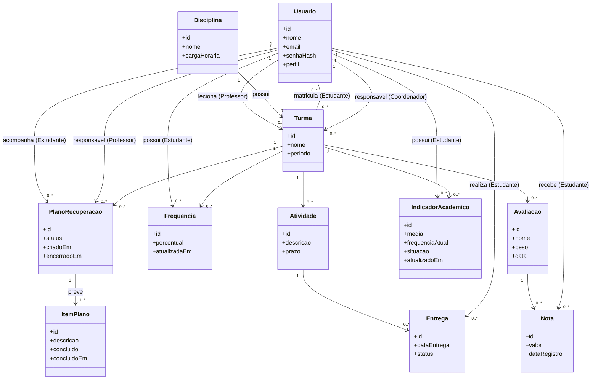

# Modelo de Domínio — StudyTrack

## Classes e responsabilidades

- **Usuario** — id, nome, email, senhaHash, perfil {Estudante, Professor, Coordenador}. Representa qualquer pessoa que acessa o sistema; o atributo `perfil` define o papel (um usuário, não classes separadas).
- **Turma** — id, nome, período.
- **Disciplina** — id, nome, cargaHoraria.
- **Avaliacao** — id, nome/tipo, peso, data.
- **Nota** — id, valor, dataRegistro.
- **Frequencia** — id, percentual, atualizadaEm.
- **Atividade** — id, descrição, prazo.
- **Entrega** — id, dataEntrega, status {NoPrazo, Atrasada, Pendente}. O status é **derivado** de prazo, data da entrega e data atual (OPEN-010); só a entrega registrada é persistida, e "Pendente"/"Atrasada" sem entrega não geram registro.
- **IndicadorAcademico** — id, media, frequenciaAtual, situacao {Normal, Atenção, Risco}, atualizadoEm.
- **PlanoRecuperacao** — id, status {Ativo, Encerrado}, criadoEm, encerradoEm. O progresso é **derivado** dos itens (RB-12), não gravado (OPEN-021).
- **ItemPlano** — id, descrição, concluído, concluídoEm. Item próprio do plano, visível só ao professor (OPEN-021).

## Relacionamentos e multiplicidades

- Um Usuario (Professor) leciona de 0 a N Turmas; cada Turma pertence a exatamente 1 Professor responsável.
- Uma Disciplina possui de 0 a N Turmas; cada Turma pertence a exatamente 1 Disciplina.
- Um Usuario (Estudante) matricula-se em 0 a N Turmas; cada Turma possui de 0 a N Estudantes (N:M).
- Uma Turma possui de 0 a N Avaliações; cada Avaliação pertence a exatamente 1 Turma.
- Uma Avaliação recebe de 0 a N Notas; cada Nota pertence a exatamente 1 Avaliação e a exatamente 1 Estudante.
- Um Estudante possui, por Turma, exatamente 1 registro de Frequência vigente.
- Uma Turma possui de 0 a N Atividades; cada Atividade pertence a exatamente 1 Turma.
- Uma Atividade gera de 0 a N Entregas (uma por estudante); cada Entrega refere-se a exatamente 1 Atividade e 1 Estudante.
- Um Estudante possui, por Turma, exatamente 1 Indicador Acadêmico vigente (RB-09, RB-10).
- Um Estudante em Risco pode ter de 0 a N Planos de Recuperação (RB-11), no máximo 1 Ativo por Turma; cada Plano pertence a exatamente 1 Turma, é responsabilidade de exatamente 1 Professor (o da turma) e contém de 1 a N Itens previstos (RB-12, OPEN-021).
- Um Usuario (Coordenador) é responsável por 0 a N Turmas; cada Turma pode ter, opcionalmente, 1 Coordenador responsável.

## Diagrama de classes (versionável — GitHub renderiza Mermaid nativamente)

