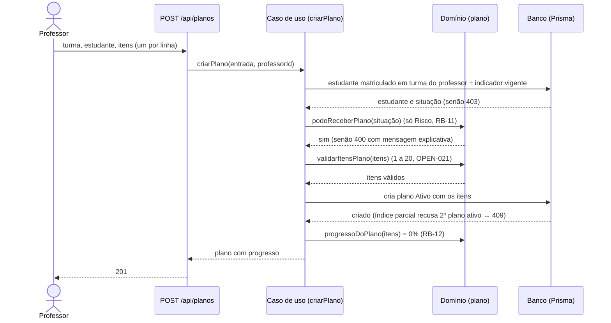

# Diagramas de sequência — StudyTrack

Mostram como uma requisição atravessa as camadas (ADR-001): rota fina em `src/app/api`, caso de uso em
`src/server/academico`, regra pura em `src/domain` e dados em `src/server/dados`, sempre com o escopo
dentro da própria consulta (ADR-003).

## UC-03 Registrar nota (SPEC-004) com recálculo do indicador (RB-10, DA-02)

```mermaid
sequenceDiagram
    actor P as Professor
    participant R as POST /api/notas
    participant G as Guarda (autorizarApi)
    participant C as Caso de uso (registrar nota)
    participant D as Domínio (registro-notas, situacao-academica)
    participant B as Banco (Prisma)

    P->>R: turma, avaliação, estudante, valor
    R->>G: verifica sessão e perfil Professor
    G-->>R: sessão válida (senão 401/403)
    R->>C: registrarNota(entrada, professorId)
    C->>B: avaliação da turma que o professor leciona? (escopo na query)
    B-->>C: encontrada (senão 403)
    C->>D: validarValorNota(valor) (0 a 10, OPEN-002)
    D-->>C: valor válido (senão 400 com o campo)
    C->>B: início da transação
    C->>B: grava a nota (se já existir: 409; a alteração é PATCH /api/notas/:id)
    C->>B: notas ponderadas e frequência do estudante
    C->>D: calcularMedia + classificarSituacao
    D-->>C: média e Normal/Atenção/Risco
    C->>B: grava o indicador vigente
    C->>B: fim da transação (tudo ou nada)
    C-->>R: nota e indicador
    R-->>P: 201 com a nova situação
```

## UC-04 Criar plano de recuperação (SPEC-008)


